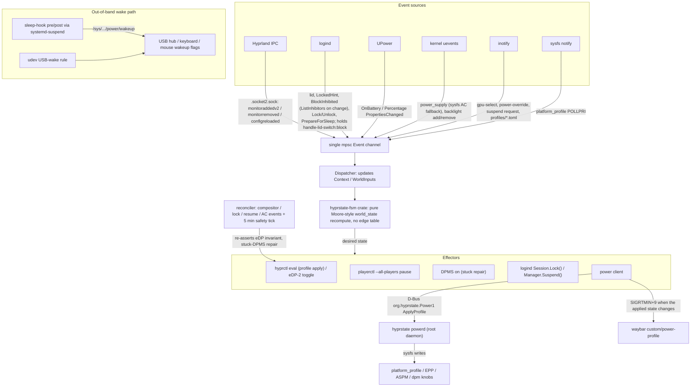
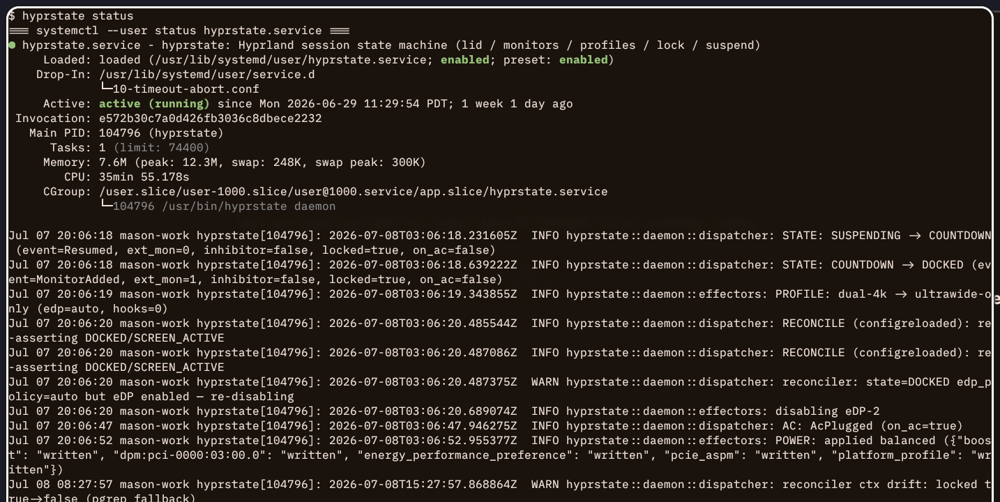

# hyprstate

Single-process session state machine for Hyprland on Framework 16. Owns lid, monitor profiles, eDP-2, lock, suspend, and USB-wake.

## What it owns

- **Lid switch.** Holds a logind `handle-lid-switch:block` inhibitor so logind doesn't suspend on lid close. The FSM decides instead.
- **eDP-2 enable/disable.** Disabled when lid closed, re-enabled (via `hyprctl reload`) when lid opens. Hard invariant, re-asserted on `configreloaded` and by the reconciler, which runs on compositor, lock, resume and AC events plus one safety tick every 5 min (see [Event sources](#event-sources-not-pollers)).
- **Monitor profiles.** Auto-applies a profile based on the set of currently-connected monitors. Profiles are neutral TOML ([monitor-profiles](https://github.com/MasonRhodesDev/monitor-profiles)) read from `~/.config/hypr/profiles/` and the shared `/etc/monitor-profiles/`, with the Hyprland config rendered from them. Legacy `.conf`/`.lua` profiles still load; `hyprstate profile migrate` converts them.
- **Suspend grace.** Lid close → 30s window before suspending. Cancellable by lid reopen, monitor hotplug, or new idle inhibitor.
- **Idle-inhibitor awareness.** If an inhibitor is already active at lid close, media is paused (`playerctl --all-players pause`) and the countdown is deferred until the inhibitor releases. Claims are sensed from logind (idle or sleep inhibitors in block mode, with hyprstate's own lid block and the baseline daemons excluded) and from the compositor (`hyprctl clients` reporting `inhibitingIdle`), never from log text. The compositor view is sampled at lid close, at a suspend request, on each reconcile pass and, only while Deferred waits on such a claim, every 5 s. Claims made solely over D-Bus to hypridle's ScreenSaver interface (a game overlay) are not visible to the lid path.
- **Lock-before-suspend.** Calls `Session.Lock()` before `Manager.Suspend()`, waits up to 2s for a live locker (`LockedHint` plus compositor session lock). A stuck `LockedHint` aborts suspend.
- **Stuck-DPMS repair.** hyprstate never blanks outputs: hypridle owns every DPMS-off (hypr-DE's unlocked idle listener and its locked input-idle listener). If hypridle loses its wake and a live session is left driving dark panels, the reconciler turns them back on once presence is proven (unlocked, or cursor movement between two passes while locked). Passes run on events and a 5 min safety tick, so a locked dark session can take up to two ticks to relight; an unlocked one is relit on the unlock edge. Known loss versus 2.4: a panel hotplugged into a blanked, locked session stays lit until the next input→idle cycle; re-blanking it here would make hyprstate a second DPMS-off writer. Same class: Hyprland warps the cursor when a monitor disconnects, which the backstop reads as presence and relights the remaining panels. Requires hypr-DE ≥ 0.2.25 (hypr-DE#27): on older hypr-DE a locked session holding an idle inhibitor is blanked by nobody. An inhibitor appearing or releasing no longer changes a locked screen; only input (or unlock) relights it.
- **Input-device wake.** A pre/post systemd-sleep hook keeps `/sys/.../power/wakeup` enabled on USB hubs, the ZSA Voyager keyboard, and the Logitech Lightspeed mouse.

## Architecture

All event sources feed one channel; the FSM is a pure function of accumulated world state, and effectors are the only code that touches the system.



## Event sources, not pollers

Since 2.8.0 the daemon has no periodic reader except one safety tick every
5 min. Every input has an event source; the tick re-reads everything as the
net under a missed event, and a reconcile pass (one `hyprctl monitors`, one
`hyprctl clients`, three logind reads) happens only after an event that can
have moved the world.

| Input | Source | Catch-up |
|---|---|---|
| monitors, eDP state, DPMS | socket2 events, then one `hyprctl monitors` per reconcile pass | safety tick |
| lid, LockedHint, sleep and resume | logind PropertiesChanged and PrepareForSleep; Session Lock/Unlock trigger a pass | reconcile re-reads |
| keep-awake claims | logind BlockInhibited then ListInhibitors; `hyprctl clients` at lid close, at a suspend request, on each pass, and every 5 s only while Deferred waits on a claim | reconcile re-reads |
| AC and battery | UPower PropertiesChanged; the kernel power_supply uevent read from sysfs when UPower is down (same 5 s settle path) | reconcile re-reads sysfs |
| platform_profile | sysfs notify (POLLPRI on the open attribute) | safety tick |
| gpu-select, power-override, suspend request, profile TOML dirs | inotify (`*.toml` only; the daemon's own renders do not echo) | safety tick |
| backlight device | kernel backlight add/remove uevent | none needed |
| waybar power module | SIGRTMIN+9 from the daemon when the applied profile, override mode or powerd reachability changes | none; the module runs on the signal |

## Layout

```
src/, crates/   Rust sources — a single `hyprstate` binary (daemon, powerd, CLI)
dist/           packaged units, dbus policy, udev rule, sleep hook, presets
packaging/      hyprstate.spec (Fedora), PKGBUILD (Arch), build-srpm.sh, migrate-from-devinstall.sh
```

## Subcommands

```
hyprstate daemon                  # run the FSM (systemd --user)
hyprstate powerd                  # root power effector (systemd system, org.hyprstate.Power1)
hyprstate sleep-hook pre|post     # invoked by systemd-suspend (root)
hyprstate status                  # systemctl + journalctl + gpu + power summary
hyprstate power set|get|cycle|status [--waybar]
hyprstate gpu select|check|status # GPU-primary selection (see GPU_SPEC.md)
hyprstate profile list|current|switch|save [NAME]
hyprstate profile migrate [NAME]  # legacy .conf/.lua -> neutral TOML
hyprstate profile verify [NAME]   # prove a conversion preserved the layout
```

## Shared monitor profiles

Layouts live in two places and are read from both:

| Directory | Who reads it |
|---|---|
| `/etc/monitor-profiles/` | this daemon **and the greeter** ([vigil](https://github.com/MasonRhodesDev/vigil)) |
| `~/.config/hypr/profiles/` | this daemon only; a same-named profile wins |

Putting a profile in the system directory is what makes the login screen
arrange monitors the way the session will, instead of falling back to the
order the kernel happens to report them in. The package creates it as
`2775 root:monitor-profiles`, so editing layouts needs group membership
rather than root:

```sh
sudo gpasswd -a "$USER" monitor-profiles   # re-login for it to take effect
```

No username is baked into the packaging — the admin decides who is in the
group. An absent directory is not an error; it just means no shared profiles.

`profile migrate` converts legacy `.conf`/`.lua` profiles to TOML and refuses
any conversion that would yield zero monitors; `profile verify` re-parses both
forms and reports any drift. Both are pure file operations and do not touch
the running compositor.

## Install

Packaged install only (Fedora COPR / Arch). The binary is built with `cargo
build --release`; the units, dbus policy, udev rule, sleep hook, and presets
are installed from `dist/` by the spec / PKGBUILD.

**Arch** — add the `[mason]` repo to `/etc/pacman.conf`, then install:

```ini
[mason]
# Import the signing key first: https://github.com/MasonRhodesDev/arch-repo#use-it
SigLevel = Required DatabaseRequired
Server = https://masonrhodesdev.github.io/arch-repo/x86_64
```

```sh
sudo pacman -Sy hyprstate
```

**Fedora**

```sh
sudo dnf copr enable solaris765/hyprstate
sudo dnf install hyprstate
```

Then enable the units:

```sh
sudo systemctl enable --now hyprstate-powerd     # root effector
systemctl --user enable --now hyprstate          # session daemon
```

hyprstate's powerd is the **exclusive owner of `platform_profile`** — its unit
`Conflicts=` `power-profiles-daemon`, `tuned`, and `tlp`. Install disables those
on first install (RPM `%post`; Arch `.install` hook) so the boot-time owner is
deterministic. Don't re-enable them alongside hyprstate.

Migrating off the old git-symlink / `install.sh` dev install: run
`packaging/migrate-from-devinstall.sh` once (it removes the `/usr/local`
symlink, the libexec copy, and the `/etc` drop-ins that would shadow the
packaged files), then install the package.

## Releasing

1. Bump the version — `Cargo.toml` (source of truth), `Cargo.lock`, spec
   `Version` (+ `%changelog`), PKGBUILD `pkgver` — in one commit.
2. `git tag vX.Y.Z && git push --tags`

The tag push triggers the release workflow (a thin caller of
[packaging-workflows](https://github.com/MasonRhodesDev/packaging-workflows)),
which does the rest automatically:

- builds the Arch package and attaches it to the tag's GitHub Release,
- pings [arch-repo](https://github.com/MasonRhodesDev/arch-repo) to republish
  the `[mason]` pacman database (otherwise it picks the release up on its
  scheduled run),
- COPR rebuilds the SRPM off its GitHub webhook via `.copr/Makefile`, which
  runs `packaging/build-srpm.sh`.

`packaging/build-srpm.sh` remains fully functional for local use: `--head`
builds an SRPM from HEAD for testing, and `--copr` is still available for a
manual COPR submit if the webhook path is ever unavailable.

## Debug

`hyprstate status` shows unit health plus the recent STATE / PROFILE / POWER transition log:



```
journalctl --user -u hyprstate.service -f       # daemon log
journalctl -u hyprstate-powerd.service -f       # powerd log
sudo tail -f /var/log/hyprstate-sleep.log       # sleep hook log
```

## Dependencies

System: `hyprctl`, `playerctl`, any screen locker that sets logind's `LockedHint` and holds ext-session-lock-v1 (vigil-lock, hyprlock, swaylock, …); hyprstate requires both `LockedHint` and `hyprctl locked` before suspend. `hypridle` drives the idle ladder and the suspend request; its journal is not read. Build: `cargo` / `rustc`.
